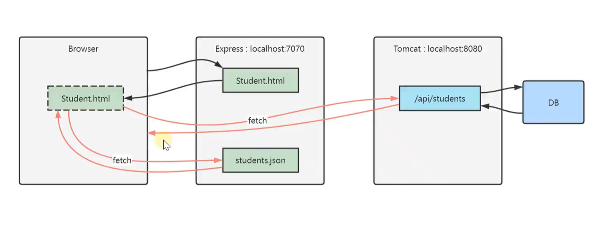
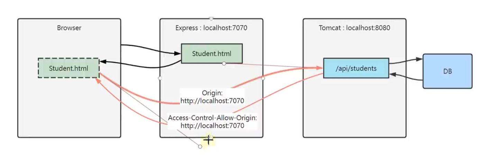

# 2026.10.18 Node 生态 / JS 常用 API / 跨域

## 一、nvm 管理多个版本的 Node.js

**nvm（Node Version Manager）**：Node.js 的**版本管理器**，用来在同一台电脑上**安装多个 Node 版本并随时切换**。

**为什么需要它**：不同项目可能依赖不同 Node 版本（老项目跑在 Node 14，新项目要 Node 20+），直接装一个版本会互相冲突。

**常用命令**

```bash
nvm list                  # 查看已安装的版本
nvm install 18.20.0       # 安装指定版本
nvm use 18.20.0           # 切换版本（当前终端生效）
nvm current               # 当前使用的版本
nvm uninstall 18.20.0     # 卸载
nvm version               # nvm 自己的版本
```

**要点**

- `nvm use` 一般只对**当前终端**生效，新开终端会回到默认版本（可以设 `nvm alias default 18.20.0`）；
- **切换版本后要重新 `npm install`**：不同 Node 版本下编译的原生模块（如 `node-sass`）可能不兼容；
- 项目里建议用 **`.nvmrc`** 文件记录需要的版本，进来执行 `nvm use` 即可。

## 二、npm 是什么

**npm（Node Package Manager）**：**Node.js 的包管理器**，作用类似 Java 的 **Maven**。

- **管理依赖**：从远程仓库下载第三方包、声明版本、解决传递依赖；
- **管理项目**：`package.json` 记录项目信息、依赖和脚本；
- **运行脚本**：`npm run xxx` 执行 `package.json` 里配置的命令（相当于 Maven 的 lifecycle）；
- **发布包**：把自己写的包发布到 npm 公共仓库。

**和 Maven 的对照**

| npm | Maven | 说明 |
| --- | --- | --- |
| `package.json` | `pom.xml` | 项目描述 + 依赖声明 |
| `package-lock.json` | 无完全对应（`pom.xml` 的锁定版本 + 传递依赖树） | **锁定每个包的精确版本**，保证不同机器装出完全一致的依赖 |
| `node_modules/` | 本地仓库（`~/.m2/repository`） | 存放实际下载的包（但 `node_modules` 是**放在项目里**的） |
| `npm install` | `mvn install` | 下载依赖 |
| `npm run build` | `mvn package` | 执行脚本/构建 |
| `npm publish` | `mvn deploy` | 发布 |

**常用命令**

```bash
npm init -y                     # 初始化，生成 package.json
npm install express             # 安装依赖，写入 dependencies
npm install express --save-dev  # 安装为开发依赖，写入 devDependencies
npm install                     # 按 package.json 装齐所有依赖（类比 mvn install）
npm uninstall express           # 卸载
npm run dev                     # 执行 package.json 里的 scripts.dev
npm ls                          # 查看依赖树
```

**`dependencies` 和 `devDependencies` 的区别**：前者是**运行时**需要的（框架、工具库），后者只在**开发/构建**时需要（测试框架、打包工具、lint）。`--save-dev` 装到 `devDependencies`。

## 三、node、npm、nvm 是什么，它们的区别

| 名称 | 是什么 | 类比 | 关键点 |
| --- | --- | --- | --- |
| **nvm** | **版本管理器**（装 node 的工具） | 类似 JDK 版本切换工具（如 SDKMAN） | 管的是「**装哪个版本的 node**」，一个系统可装多个 node |
| **node** | **JavaScript 运行时**（让 JS 能在浏览器外跑） | **JVM / JDK** | 管的是「**代码在哪跑**」；自带 `node xxx.js` 执行 |
| **npm** | **包管理器**（装第三方库） | **Maven** | 管的是「**项目要哪些依赖**」；**随 node 一起安装**（不用单独装） |

**层次关系**：

```
nvm  →  管理多个 node 版本
          └─ 每个 node 自带一个 npm
                └─ npm 用来安装项目依赖（express 等）
```

**记住三点**

- **有 node 就有 npm**（npm 跟着 node 一起装）；
- **nvm 是 node 的上游**，切了 node 版本，npm 版本也跟着变；
- **三者都只是开发环境工具**，最终跑在浏览器/服务器上的还是 JS 代码。

## 四、用 npm 搭建简单服务

**步骤**

```bash
npm init -y                          # 生成 package.json
npm install express --save-dev       # 安装 express
node server.js                       # 启动服务
```

**`package.json` 相当于 Maven 的 `pom.xml`**（管理相关依赖），**实际的 js 包存在 `node_modules` 文件夹里**。

```json
{
  "name": "my-web",
  "version": "1.0.0",
  "type": "module",
  "scripts": {
    "dev": "node server.js"
  },
  "devDependencies": {
    "express": "^4.19.2"
  }
}
```

**几个要点**

- **`node_modules` 很大，不要提交到 git**（用 `.gitignore` 排除），别人拿到项目后 `npm install` 自己装；
- **`package-lock.json` 要提交**：它锁定精确版本，保证团队安装结果一致；
- **版本号 `^4.19.2`**：`^` 表示「允许更新次版本和补丁版本，不跨大版本」，`~` 更保守，精确版本就是 `4.19.2`；
- **`"type": "module"`**：开启 ES Module（才能用 `import`），否则要用 `require`。

## 五、express 相当于 Java 后端的 Tomcat 服务器

**express** 是 Node.js 最流行的 **Web 框架**：提供路由、中间件、静态文件服务等能力，作用上对应 Java 的 **Tomcat + Spring MVC**（提供 HTTP 服务与请求处理）。

- **Tomcat** 是 **Web 容器**（接收 HTTP 请求、交给 Servlet）；
- **Spring MVC** 是**框架**（路由、参数绑定）；
- **express** 一个包同时承担这两层职责，所以可以说「**express ≈ Tomcat + Spring MVC 的简化版**」。

## 六、创建一个最基础的 express 前端服务器

```js
import express from "express"

const app = express()

app.use(express.static('./'))

app.listen(7070)
```

**逐行理解**

| 代码 | 作用 |
| --- | --- |
| `import express from "express"` | 引入 express（ES Module 写法；若没有 `"type": "module"` 要用 `const express = require("express")`） |
| `const app = express()` | 创建应用实例 |
| `app.use(express.static('./'))` | **静态文件服务**：把当前目录下的文件（html/css/js/图片）直接对外提供，浏览器访问 `http://localhost:7070/index.html` 就能拿到 |
| `app.listen(7070)` | 监听 7070 端口，开始接收请求 |

**为什么叫「前端服务器」**：它只负责**把静态文件发给浏览器**（托管 HTML/CSS/JS），不处理业务逻辑。前端项目开发时常常起这样一个本地服务，让浏览器能通过 `http://` 访问页面（**直接用 `file://` 打开会有跨域、模块加载等限制**）。

**补充：加一个接口和路由中间件**（这样就同时能托管页面和提供 API）

```js
app.get('/api/hello', (req, res) => {
  res.json({ code: 200, msg: 'ok', data: 'hello' })
})
```

## 七、JS 的常用 API

**修改标签内容**

```js
document.querySelector('.title').innerHTML = '新的标题';
```

- `document.querySelector(选择器)` 返回**第一个匹配的元素**（CSS 选择器写法，类名带 `.`、id 带 `#`）；
- 想拿多个用 `document.querySelectorAll()`（返回 NodeList，可 `forEach`）；
- 少写错：选择器字符串**引号要配对**（`querySelector(".title")`）。

## 八、`innerHTML` 和 `textContent` 的区别

| 对比项 | `innerHTML` | `textContent` |
| --- | --- | --- |
| 内容如何解释 | **按 HTML 解析**（会被渲染成标签） | **按纯文本处理**（标签原样显示） |
| 示例 | `el.innerHTML = "<b>hi</b>"` → 加粗显示 | `el.textContent = "<b>hi</b>"` → 显示字面量 `<b>hi</b>` |
| 安全性 | **有 XSS 风险**（会执行注入的脚本/事件） | **安全**（不会被解析执行） |
| 性能 | 解析 HTML，较慢 | 纯文本赋值，较快 |
| 读取时 | 返回内部 HTML 源码 | 返回纯文本内容 |

**结论**：**展示用户输入一律用 `textContent`**；只有插入「可信的 HTML 片段」时才用 `innerHTML`（或用 `createElement` + `textContent` 手工构建，最安全）。

## 九、利用模板 template 来更新标签内容 / 表格内容

```html
<template id="row-tpl">
  <tr>
    <td class="name"></td>
    <td class="price"></td>
  </tr>
</template>
<table><tbody id="body"></tbody></table>
```

```js
const tpl = document.getElementById('row-tpl');
const tbody = document.getElementById('body');

rowList.forEach(item => {
  const node = document.importNode(tpl.content, true);   // ① 复制模板内容（true = 深拷贝）
  node.querySelector('.name').textContent = item.name;   // ② 填充数据
  node.querySelector('.price').textContent = item.price;
  tbody.appendChild(node);                               // ③ 插入页面
});
```

**要点**

- **`<template>` 的内容不渲染**，只在 `template.content`（一个 DocumentFragment）里「存着」，非常适合做**行模板**；
- **`document.importNode(节点, 是否深拷贝)`**：复制模板内容（**跨文档导入**用 `importNode`，同一文档内用 `cloneNode` 更轻）；
- **`appendChild(节点)`**：把节点追加为**最后一个子节点**；
- 循环里频繁 `appendChild` 会触发多次重排，可以先放到 `DocumentFragment` 里**一次性插入**。

## 十、一个元素复制和增加子元素

`document.importNode()` 复制一个元素，`appendChild()` 增加一个子元素

| API | 作用 | 说明 |
| --- | --- | --- |
| `document.importNode(node, deep)` | **复制**一个节点（可用于跨文档） | `deep = true` **深拷贝**（连子节点一起）；`false` 只拷贝自身 |
| `node.cloneNode(true)` | 复制节点（同一文档内） | 语义相同，**更常用** |
| `parent.appendChild(child)` | 把 child 追加为**最后一个子节点** | 如果 child 已在页面上，会被**移动**过去 |
| `parent.insertBefore(newNode, refNode)` | 插到某个节点**之前** | 能做「插到最前面」 |
| `node.remove()` / `parent.removeChild(child)` | 删除节点 | |
| `parent.replaceChild(newNode, oldNode)` | 替换子节点 | |
| `document.createElement("div")` | 创建新元素 | 常配合 `textContent` 使用 |

## 十一、Fetch API 与 Promise

```js
const res = await fetch(url, options)
```

**`fetch(url, options)` 返回的是 `Promise`，不是最终结果** —— 类似 Java 的 `CompletableFuture`（代表「将来会完成」的任务），需要用 `await` 或 `.then()` 取出结果。

**注意：`fetch` 拿到 Response 后，还要再解析一次响应体**

```js
const res = await fetch(url);     // res 是 Response 对象（不是数据）
const data = await res.json();    // ★ 再 await 一次，才是真正的 JSON 数据
```

- `res.json()`、`res.text()`、`res.blob()` 都**返回 Promise**，都要再 await；
- `fetch` **只有网络错误才会 reject**，**HTTP 4xx/5xx 不会 reject**（要自己判断 `res.ok` 或 `res.status`）：

```js
if (!res.ok) throw new Error("HTTP " + res.status);
```

**options 常用字段**：`method`（GET/POST…）、`headers`（如 `Content-Type: application/json`）、`body`（请求体，POST 时用 `JSON.stringify`）。

## 十二、同步方式：`await` 与 try/catch

```js
async function load() {
  try {
    const res = await fetch('/api/list');
    if (!res.ok) throw new Error('HTTP ' + res.status);
    const data = await res.json();
    console.log(data);
  } catch (err) {
    console.error("请求失败：", err);
  }
}
```

- **`await` 会「暂停」当前函数**，等 Promise 有了结果再继续 —— 后续代码**不会提前执行**（看起来像「阻塞」，但**不会阻塞整个线程**，只是挂起当前异步函数）；
- **用 `try/catch` 捕获异常**：await 的 Promise 被 reject 时，会在 await 处**抛出异常**，所以包 try/catch；
- **`await` 必须写在标记了 `async` 的函数里**（你记的这条关键点）：

```js
function bad() {
  const r = await fetch(url);     // ❌ SyntaxError：await 只能出现在 async 函数中
}

async function good() {
  const r = await fetch(url);     // ✅
}
```

- 另外：**`await` 在模块顶层也可用**（ES2022 的 top-level await，在 `type="module"` 里可以）。

## 十三、异步方式：`Promise.then()` 链式调用

```js
fetch('/api/list')
  .then(res => {
    if (!res.ok) throw new Error('HTTP ' + res.status);
    return res.json();            // ★ 返回 Promise，下一个 then 才能拿到数据
  })
  .then(data => {
    console.log(data);            // 这里才是真正的数据
  })
  .catch(err => {
    console.error("出错：", err);  // 统一的错误处理
  })
  .finally(() => {
    console.log("请求结束");       // 无论成功失败都会执行
  });
```

- **`then` 能链式调用的前提：前一个 `then` 的回调「返回了 Promise」**（你记的这条对）—— 如果回调返回普通值，下一个 `then` 收到的是那个值，同样可以继续链；返回 Promise 时，下一个 `then` 会**等它完成**再执行；
- **`.catch()` 捕获链上任意一环抛出的异常**（包括回调里 throw 的、以及 fetch 被 reject 的），写在最后即可；
- `.finally()` 不管成功失败都执行，适合清理工作（关闭 loading）；
- **`then` 里的回调都是异步执行的**（微任务），不会卡住主线程。

**两种写法怎么选**：`async/await` 更接近同步代码、可读性好，**优先用它**；`then` 适合简单链式处理或多步并行的组合。

## 十四、跨域请求

### 什么是跨域

**同源（Same Origin）指三样完全一致**：

| 组成 | 说明 | 例子 |
| --- | --- | --- |
| 协议 | http / https | `http://a.com` 与 `https://a.com` **不同源** |
| 域名 | 主机名 | `a.com` 与 `b.a.com`、`127.0.0.1` 与 `localhost` **不同源** |
| 端口 | 端口号（默认端口要写出一致） | `a.com:80` 与 `a.com:8080` **不同源** |

**只要协议、域名、端口有任意一个不同，就是跨域请求**。

### 浏览器的同源策略

- **同源策略是浏览器的一种安全机制**：限制页面脚本**读取**其他源的响应，防止恶意站点窃取数据（比如读取你网银页面的内容）；
- **注意：请求本身往往已经发出去了** —— 浏览器**发请求、也收到了响应，但会拦截「把响应交给 JS 读取」这一步**（所以后端日志里能看到请求，前端却报 CORS 错误）；
- **同源检查是浏览器的行为，而且只针对 `fetch`、`XMLHttpRequest` 这类脚本发起的请求**（你记的这条对）：
  - ``、`<script>`、`<link>` 这类「标签资源加载」不受同源限制（所以有 JSONP 这种老方案）；
  - 用 Postman、后端服务、`curl` 直接调接口**没有跨域问题**（没有浏览器）；
  - 两个后端服务之间调用也不涉及跨域。

### 请求链路图（不同源失败场景）

浏览器-前端服务器-后端服务器的请求链路图（不同源失败场景）



成功场景：



> 两张图分别是「跨域被拦截」与「放行成功」的链路示意：前端页面（如 `localhost:7070`）里用 fetch 调后端（如 `localhost:8080`），**端口不同即跨域**；响应缺少 CORS 头时浏览器丢弃结果，带上允许头则正常返回。

### 解决办法

**你记的四条，按推荐程度排列**：

| 方案 | 做法 | 说明 |
| --- | --- | --- |
| **① 注解**（最简单） | `@CrossOrigin(origins = "http://localhost:7070")` 加在 Controller 方法或类上 | 只影响该接口/类，适合临时调试 |
| **② 全局跨域配置**（后端常用） | 实现 `WebMvcConfigurer`，覆写 `addCorsMappings` | 一处配置全局生效 |
| **③ 过滤器 / 拦截器** | 手写 `Filter`，在响应里加 CORS 头，并处理 `OPTIONS` 预检请求 | 灵活，适合要统一处理头部的场景 |
| **④ Nginx 反向代理**（生产常用） | 让前端和后端**同源**：Nginx 把 `/api` 转发到后端 | **不改后端代码**，浏览器看到的一直是同源请求，最干净 |

**全局配置示例（方案②）**

```java
@Configuration
public class CorsConfig implements WebMvcConfigurer {
    @Override
    public void addCorsMappings(CorsRegistry registry) {
        registry.addMapping("/**")
                .allowedOriginPatterns("*")            // 生产别用 *，写具体来源
                .allowedMethods("GET", "POST", "PUT", "DELETE", "OPTIONS")
                .allowedHeaders("*")
                .allowCredentials(true)
                .maxAge(3600);                          // 预检结果缓存 1 小时
    }
}
```

**Nginx 反向代理示例（方案④）**

```nginx
server {
    listen 80;
    location / {
        proxy_pass http://127.0.0.1:7070;    # 前端
    }
    location /api/ {
        proxy_pass http://127.0.0.1:8080;    # 后端
    }
}
```

这样浏览器只访问 `http://localhost:80`，所有请求都是同源，跨域问题消失。

### 浏览器依靠响应头来判断是否放行

**你记的这条是关键**：跨域是否放行，**由浏览器根据响应头判断**，不是由服务器「拒绝」——

| 响应头 | 作用 |
| --- | --- |
| **`Access-Control-Allow-Origin`** | **允许哪些源访问**（`*` 或具体源；**带 Cookie 时不能是 `*`**） |
| `Access-Control-Allow-Methods` | 允许的方法 |
| `Access-Control-Allow-Headers` | 允许的请求头 |
| `Access-Control-Allow-Credentials` | 是否允许携带 Cookie（`true` 时上面不能用 `*`） |
| `Access-Control-Max-Age` | **预检（OPTIONS）结果缓存时长** |

**两个重要细节**

- **简单请求 vs 预检请求**：`GET`/简单 `POST`（`Content-Type` 是 `text/plain`、`application/x-www-form-urlencoded`、`multipart/form-data`）直接发送；**自定义请求头或 `application/json` 的 POST 会先发一个 `OPTIONS` 预检请求**，后端必须响应 CORS 头，前端才发真实请求 —— 这也是「OPTIONS 请求返回 403/404」的常见原因；
- **浏览器把响应藏起来前，服务器其实已经执行了逻辑**：所以**不要用跨域拦截做安全手段**，真正的越权防护要靠**登录鉴权（token/session）**，CORS 只是浏览器的保护。

## 十五、JS 的导入和导出

**ES Module 的 `export` / `import`**

```js
// math.js
export const PI = 3.14;                        // 命名导出
export function add(a, b) { return a + b; }
export default function hello() { }             // 默认导出（每个模块只有一个）

// main.js
import hello, { add, PI } from './math.js';     // 默认导出 + 命名导出
import * as math from './math.js';              // 全部导入到命名空间对象
```

**在 HTML 里引入**

```html
<!-- 方式一：传统脚本（全局作用域，不支持 import/export） -->
<script src="./app.js"></script>

<!-- 方式二：模块脚本（支持 import/export） -->
<script type="module" src="./main.js"></script>

<!-- 方式三：内联模块 -->
<script type="module">
  import { add } from './math.js';
  console.log(add(1, 2));
</script>
```

**要点**

- **`type="module"` 才支持 `import`/`export`**；普通 `<script src>` 里写 `import` 会报 `SyntaxError`；
- 模块脚本**默认 defer**（等文档解析完再执行）、**自动严格模式**、**顶层 `this` 是 `undefined`**；
- 模块脚本**有独立的顶层作用域**（不会污染全局变量）；
- **模块必须通过 HTTP 服务访问**（`express.static` 起的就是这个作用）：用 `file://` 直接打开会因为「模块跨源」被浏览器拦截；
- **Node.js 侧**：`package.json` 加了 `"type": "module"` 才能用 ESM 的 import，否则用 CommonJS 的 `require`/`module.exports`（两者不能在同一文件混用）；
- **导入路径**：浏览器里的模块路径通常要**带扩展名**（`./math.js`），且**相对路径**要正确。
